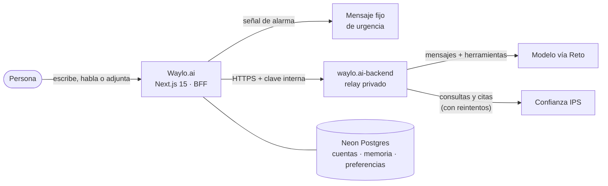
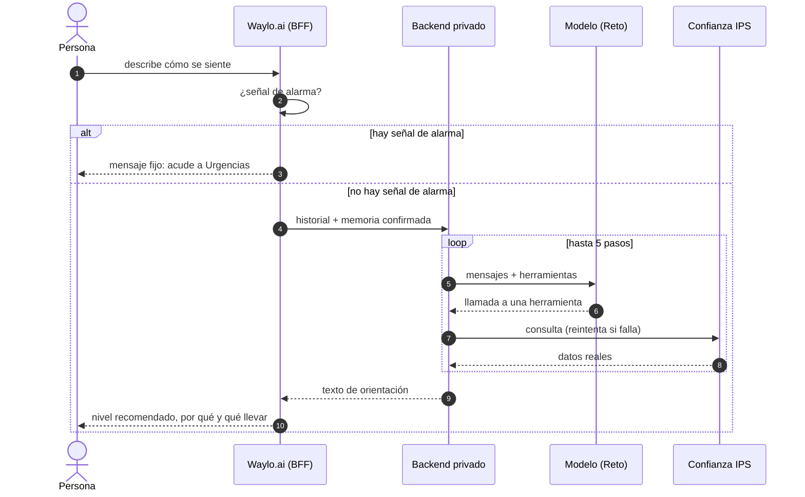

<div align="center">

<picture>
  <source media="(prefers-color-scheme: dark)" srcset="docs/assets/banner-dark.png">
  
</picture>

<br>

### Te decimos a qué nivel de atención acudir.
Orientamos, no diagnosticamos. Y cuando tu IPS está vinculada, Waylo actúa por ti con herramientas reales.

**Español** · [English](./README.en.md)

<br>

[**Probar la web**](https://waylo-ai.vercel.app) &nbsp;·&nbsp; [El agente en acción](#el-agente-en-acción) &nbsp;·&nbsp; [Arquitectura](#arquitectura) &nbsp;·&nbsp; [Empezar](#empezar) &nbsp;·&nbsp; [Documentación](./docs/README.md) &nbsp;·&nbsp; [Backend](https://github.com/GustavoAdolfoNavarroPacheco/waylo.ai-backend)

<br>

[](https://github.com/GustavoAdolfoNavarroPacheco/waylo.ai/actions/workflows/frontend-ci.yml) [](https://waylo-ai.vercel.app) [](https://github.com/GustavoAdolfoNavarroPacheco/waylo.ai/commits/main) [](./LICENSE) [](./CONTRIBUTING.md#convención-de-commits)

      

</div>

---

> [!IMPORTANT]
> **Waylo es una herramienta de orientación.** No diagnostica, no receta, no sugiere medicamentos, dosis ni remedios caseros, y no
> sustituye la valoración de un profesional de la salud. Ante cualquier señal de alarma, la respuesta es siempre la misma:
> acudir de inmediato a Urgencias o llamar a la línea de emergencias.

## Contenido

- [¿Qué es Waylo?](#qué-es-waylo)
- [Así se ve](#así-se-ve)
- [El agente en acción](#el-agente-en-acción)
- [Características](#características)
- [Arquitectura](#arquitectura)
- [Stack](#stack)
- [Empezar](#empezar)
- [Estructura del proyecto](#estructura-del-proyecto)
- [Calidad y flujo de trabajo](#calidad-y-flujo-de-trabajo)
- [Seguridad y privacidad](#seguridad-y-privacidad)
- [Documentación](#documentación)
- [Hoja de ruta](#hoja-de-ruta)
- [Repositorios relacionados](#repositorios-relacionados)
- [Equipo](#equipo)
- [Licencia](#licencia)

## ¿Qué es Waylo?

Cuando algo duele, mucha gente no sabe si ir a Urgencias, pedir una cita prioritaria o una consulta de medicina general. El
resultado: salas de urgencias saturadas con casos de baja complejidad, desplazamientos inútiles y tiempo perdido, o lo
contrario, esperar demasiado ante algo serio.

**Waylo escucha cómo te sientes, con tus propias palabras, y te dice a qué nivel de atención acudir:**

| Nivel | Cuándo | Qué recibes |
| --- | --- | --- |
| **Urgencias** | Hay señales de alarma o el caso lo requiere. | Ante una señal de alarma, un mensaje fijo y claro: acude ya a Urgencias. |
| **Consulta Prioritaria** | Algo agudo que no puede esperar a una cita normal. | El motivo, qué llevar y, con IPS vinculada, los primeros cupos. |
| **Medicina General** | Un caso que se atiende bien con una cita ordinaria. | El motivo, qué llevar y, con IPS vinculada, tus citas y cupos. |

La respuesta siempre tiene la misma forma, sencilla y breve: **nivel recomendado**, **por qué** y **qué debes llevar**.

### Cómo funciona

1. **Cuéntale cómo te sientes**: escribiendo, hablando (Waylo Live) o adjuntando un documento o una foto.
2. **Primero, las señales de alarma.** Antes de que intervenga ningún modelo de IA, una revisión determinista busca dolor u
   opresión en el pecho, dificultad grave para respirar, parálisis o alteración del habla, sangrado que no para, pérdida
   del conocimiento o pensamientos de hacerse daño.
3. **Recibes tu orientación.** Si vinculaste tu IPS, Waylo también consulta tu perfil, el catálogo, los primeros cupos y tus
   citas con herramientas reales; crear, cancelar o reprogramar una cita siempre pide tu confirmación explícita.

## Así se ve

<p align="center">
  <picture>
    <source media="(prefers-color-scheme: dark)" srcset="docs/assets/screenshots/home-dark.png">
    
  </picture>
</p>

<table>
  <tr>
    <td width="50%" valign="top">
      <picture>
        <source media="(prefers-color-scheme: dark)" srcset="docs/assets/screenshots/steps-dark.png">
        
      </picture>
      <br><sub><b>Cómo funciona</b>: tarjetas de cristal sobre formas desenfocadas.</sub>
    </td>
    <td width="50%" valign="top">
      <picture>
        <source media="(prefers-color-scheme: dark)" srcset="docs/assets/screenshots/chat-dark.png">
        
      </picture>
      <br><sub><b>El chat</b>: texto, adjuntos y voz.</sub>
    </td>
  </tr>
</table>

<p align="center">
  
  &nbsp;&nbsp;&nbsp;
  
  <br><sub>Pensado primero para el teléfono: se puede instalar en la pantalla de inicio.</sub>
</p>

## El agente en acción

Waylo no es solo un chat: cuando la persona vincula su IPS, **el agente decide por sí solo qué herramienta usar, llama a la API
real de la institución y se recupera si algo falla**.

<p align="center">
  
</p>

*Fragmento de una ejecución real: la IPS falla a propósito (503), el backend espera 204 ms, reintenta y el agente sigue hasta
encontrar el primer cupo de medicina general.*

- **Herramientas reales, no simuladas**: perfil, catálogo de servicios y médicos, primeros cupos, citas, historia
  institucional y constancias. Las operaciones que escriben (crear, cancelar, reprogramar) requieren confirmación explícita
  y firmada.
- **Errores y reintentos**: el backend reintenta con espera creciente los fallos transitorios del modelo y de la IPS, y no
  reintenta los errores permanentes de autorización.
- **Ejecuciones registradas**: cada llamada deja un registro sanitizado (estado, herramientas, reintentos, duración) en la
  tabla `agent_executions`; nunca guarda mensajes, argumentos, tokens ni claves.
- **Evidencia verificable**: **10 ejecuciones reales de punta a punta**, 10 de 10 exitosas, con 4 herramientas y 6 endpoints
  de Confianza IPS, y dos fallos inyectados que el agente recuperó. Los datos y los scripts están en
  [`docs/evidence`](./docs/evidence/README.md); el diseño, en [`docs/005`](./docs/005-hackathon-s2-delivery.md).

## Características

| Característica | Qué ofrece |
| --- | --- |
| **Orientación clara** | Nivel recomendado, motivo y qué llevar, en lenguaje sencillo; botones de respuesta rápida para síntomas comunes. |
| **Seguridad clínica primero** | Las señales de alarma se evalúan antes que el modelo, en varios idiomas a la vez, y cortan el flujo con un mensaje fijo. |
| **Agente con herramientas reales** | Perfil, catálogo, cupos, citas, historia y constancias de la IPS; reintentos, errores normalizados y trazabilidad. |
| **Voz** | Conversación por voz con Waylo Live: transcripción y respuesta hablada, con voz femenina o masculina a elegir. |
| **Adjuntos** | Imágenes, PDF, Word y Excel: se leen en el servidor y se envían con el mensaje. |
| **Memoria clínica propia** | Solo guarda lo que la persona confirma; se puede editar o borrar desde Configuración → Memoria. |
| **Cuentas y límites** | Registro con correo o Google; las personas invitadas tienen respuestas gratis y las cuentas, límites diario y mensual. |
| **Tres idiomas** | Español, inglés y portugués, con la misma forma garantizada por pruebas. |
| **Claro y oscuro** | Un diseño monocromo con transición suave entre temas, mascota animada y cursor suave; respeta el movimiento reducido. |
| **Instalable** | Manifest, icono para la pantalla de inicio (iOS y Android) y color de tema por esquema. |
| **Visible para buscadores** | Metadatos, Open Graph, sitemap, robots y datos estructurados; las respuestas de las preguntas frecuentes están en el HTML. |

## Arquitectura



El navegador **nunca** recibe claves ni el token de la IPS: las rutas `/api/*` de Next.js hacen de BFF y delegan en un backend
privado, el único que habla con el modelo y con Confianza.



Más detalle: [arquitectura técnica](./docs/producto/Architecture.md), [integración con la IPS](./docs/001-ips-integration-mvp-prd.md) y
[chat con herramientas y memoria](./docs/003-chat-ips-tools-memory-prd.md).

## Stack

| Capa | Tecnología |
| --- | --- |
| Aplicación | Next.js 15 (App Router, Turbopack), React 19, TypeScript 5 |
| Interfaz | Tailwind CSS 4, Radix UI, motion, GSAP y Lenis, Hugeicons |
| IA | Vercel AI SDK con un proveedor compatible con OpenAI (Grok vía Reto), Zod 4 |
| Datos | Neon (PostgreSQL serverless) |
| Documentos | unpdf, mammoth y read-excel-file |
| Calidad | Vitest, ESLint, GitHub Actions, CodeQL, Dependabot |
| Entrega | Docker (Node 24) y Vercel |

## Empezar

**Requisitos:** Node.js 24 (ver [`.nvmrc`](./.nvmrc)), una base de datos PostgreSQL (por ejemplo [Neon](https://neon.tech)) y,
para el chat con herramientas, el [backend](https://github.com/GustavoAdolfoNavarroPacheco/waylo.ai-backend) en marcha.

```bash
git clone https://github.com/GustavoAdolfoNavarroPacheco/waylo.ai.git
cd waylo.ai

nvm use                      # Node 24
npm install                  # instala y activa el hook de commits
cp .env.example .env.local   # completa las variables (tabla de abajo)
npm run db:migrate           # crea las tablas
npm run dev                  # http://localhost:3000
```

### Variables de entorno

Las claves son **solo del servidor**: nunca les pongas el prefijo `NEXT_PUBLIC_`.

| Variable | ¿Obligatoria? | Para qué |
| --- | :---: | --- |
| `DATABASE_URL` | Sí | Conexión a PostgreSQL (cuentas, sesiones, memoria, preferencias). |
| `AUTH_SECRET` | Sí | Firma de las sesiones y de las cookies. Una cadena aleatoria larga. |
| `WAYLO_BACKEND_URL` | Para el chat | Dirección del backend privado, p. ej. `http://localhost:3001`. |
| `WAYLO_BACKEND_KEY` | Para el chat | Clave interna que debe coincidir con la del backend (mínimo 32 caracteres). |
| `RETO_KEY` | Opcional | Proveedor de IA para la voz y el título de las conversaciones. |
| `RETO_BASE_URL`, `RETO_MODEL`, `RETO_TITLE_MODEL`, `RETO_VOICE` | Opcional | Ajustes del proveedor. |
| `AUTH_GOOGLE_ID`, `AUTH_GOOGLE_SECRET` | Opcional | Ingreso con Google. |
| `DISCORD_FEEDBACK_WEBHOOK_URL`, `DISCORD_ERRORS_WEBHOOK_URL` | Opcional | Avisos de votos y de errores ([detalles](./docs/operaciones.md)). |
| `SITE_URL` | Opcional | Dirección pública, sin barra final, para el canonical, el sitemap y las vistas previas. |

### Scripts

| Comando | Qué hace |
| --- | --- |
| `npm run dev` | Servidor de desarrollo con Turbopack. |
| `npm run build` / `npm start` | Compila y sirve la versión de producción. |
| `npm run lint` | ESLint. |
| `npm test` | Pruebas con Vitest. |
| `npm run db:migrate` | Aplica las migraciones a la base de datos. |

### Con Docker

```bash
docker build -t waylo-frontend .
docker run --rm --env-file .env -p 3000:3000 waylo-frontend
```

Más en [`docs/docker.md`](./docs/docker.md).

## Estructura del proyecto

```text
src/
├── app/          Rutas (App Router): páginas, API que hace de BFF, manifest, iconos e imagen social
├── components/   Interfaz: home, chat, live (voz), mascot, settings, cursor, theme, ui
├── lib/          Lógica de servidor y dominio: triage, señales de alarma, IPS, memoria, sesión, uso
├── i18n/         Textos en es / en / pt y la forma común que las pruebas exigen
├── design/       Tokens de diseño y de movimiento
└── data/         Datos semilla
scripts/          Migraciones y comprobación de mensajes de commit
docs/             Producto, integración con la IPS, evidencia del agente, operación e imágenes
.github/          CI, CodeQL, Dependabot, plantillas y propietarios del código
```

## Calidad y flujo de trabajo

- **Pruebas:** más de 450 pruebas automáticas con Vitest, incluidas las de las señales de alarma, la forma común de los tres
  idiomas y los contratos de la integración con la IPS.
- **Integración continua:** cada push y pull request ejecuta lint, pruebas y compilación; además hay análisis con CodeQL y
  actualizaciones semanales de dependencias con Dependabot.
- **Commits convencionales:** `tipo: descripción`, en minúsculas y en inglés, comprobados con un hook local y con un check del
  pull request. Ver [CONTRIBUTING.md](./CONTRIBUTING.md#convención-de-commits).
- **Accesibilidad:** colores de texto con contraste de al menos 4,5:1 en los dos temas, foco visible y respeto de `prefers-reduced-motion`.

## Seguridad y privacidad

- Las claves viven solo en el servidor; el navegador nunca recibe el token de la IPS.
- Las señales de alarma se evalúan **antes** del modelo y no consultan datos institucionales.
- Las conversaciones se guardan en el navegador de la persona (hasta 7 días), no en el servidor.
- La memoria clínica solo incluye lo que la persona confirmó y puede borrarla.
- Los avisos de error ocultan contraseñas, tokens y correos, y nunca incluyen el texto de la conversación.

¿Encontraste una vulnerabilidad? Reporta de forma privada siguiendo [SECURITY.md](./SECURITY.md).

## Documentación

Todo está indexado en [`docs/README.md`](./docs/README.md): producto y límites clínicos, integración con la IPS, memoria y
herramientas del chat, el hito del agente con su evidencia, auditoría de pruebas, Docker y operación.

## Hoja de ruta

- [x] Orientación por niveles con detección de señales de alarma
- [x] Cuentas, memoria clínica confirmada, tres idiomas, voz y adjuntos
- [x] Integración con Confianza IPS y agente con herramientas reales, reintentos y registro de ejecuciones
- [ ] Auditoría clínica de las respuestas con un profesional de la salud
- [ ] Regenerar el `package-lock.json` y pasar a `npm ci` en CI y en Docker
- [ ] Publicar la primera versión etiquetada

## Repositorios relacionados

| Repositorio | Papel |
| --- | --- |
| [`waylo.ai-backend`](https://github.com/GustavoAdolfoNavarroPacheco/waylo.ai-backend) | Relay privado hacia el modelo y la IPS, herramientas, reintentos y registro de ejecuciones. |
| [`confianza-ips-frontend`](https://github.com/Duran24062005/confianza-ips-frontend) | La IPS de integración con la que Waylo se conecta. |

## Equipo

<table>
  <tr>
    <td align="center" width="140"><a href="https://github.com/GustavoAdolfoNavarroPacheco"><br><sub><b>GustavoAdolfoNavarroPacheco</b></sub></a></td>
    <td align="center" width="140"><a href="https://github.com/Duran24062005"><br><sub><b>Duran24062005</b></sub></a></td>
    <td align="center" width="140"><a href="https://github.com/ThomR08"><br><sub><b>ThomR08</b></sub></a></td>
  </tr>
</table>

¿Quieres colaborar? Lee [CONTRIBUTING.md](./CONTRIBUTING.md) y el [Código de Conducta](./CODE_OF_CONDUCT.md).

## Licencia

**Propietaria, todos los derechos reservados.** El código es público para que pueda consultarse y evaluarse, pero no se ofrece
bajo una licencia de código abierto: no se puede copiar, modificar ni reutilizar sin permiso. Ver [LICENSE](./LICENSE).

<div align="center">
<br>
<sub>Waylo orienta, no diagnostica ni receta. Si te sientes muy mal, ve a Urgencias.</sub>
</div>
