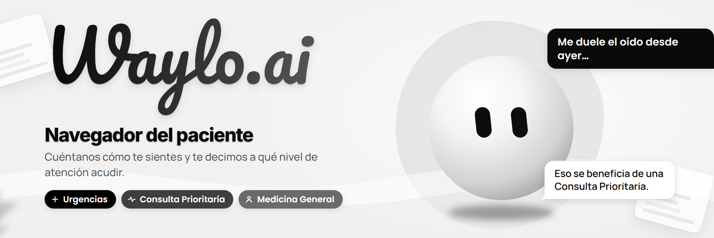
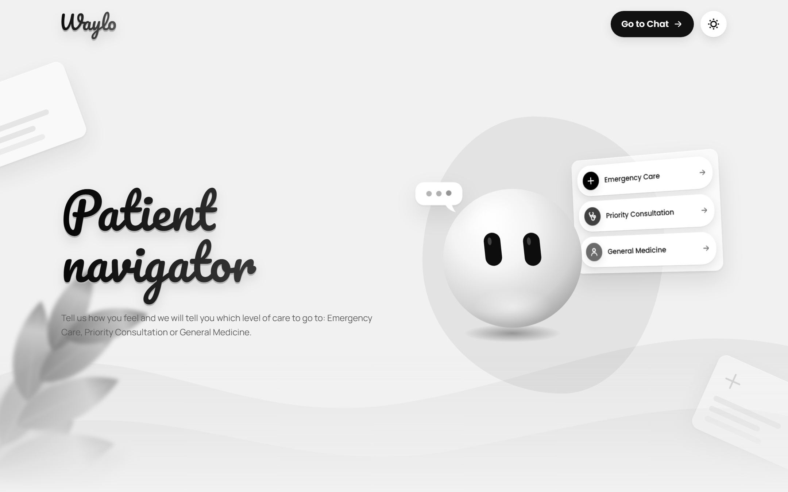
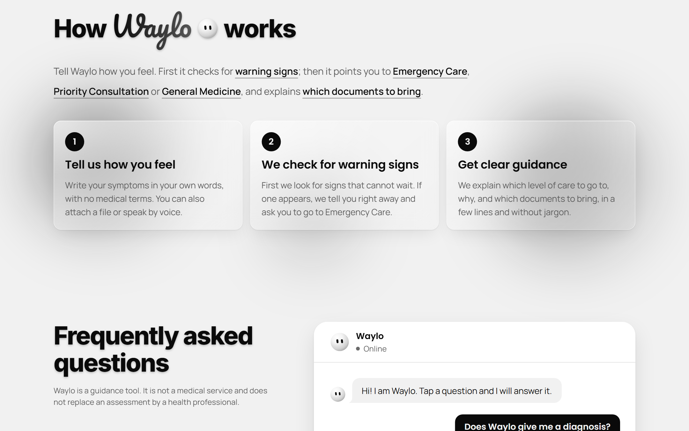
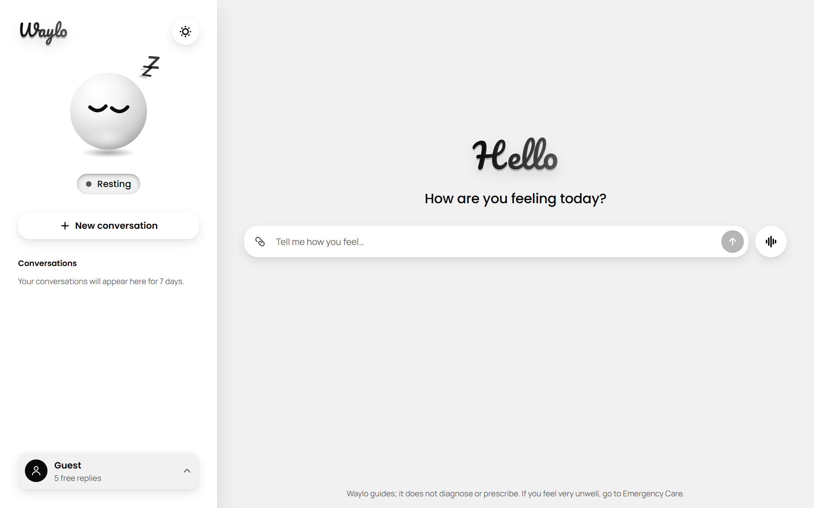
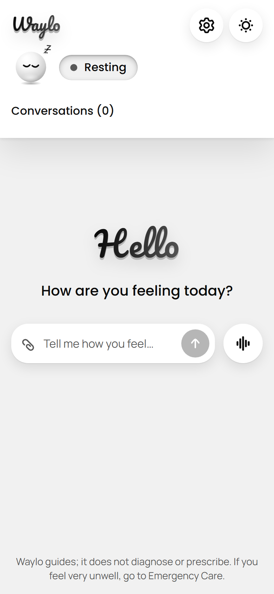
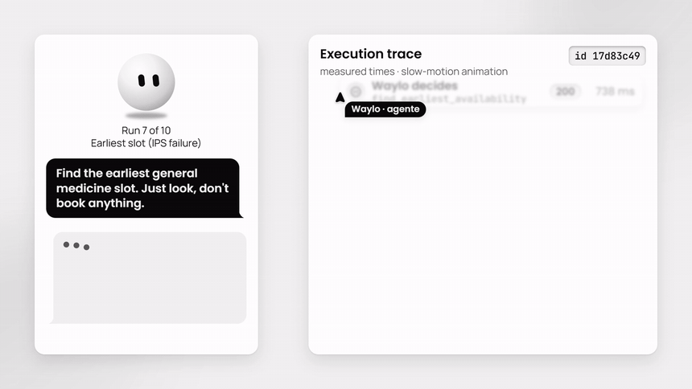
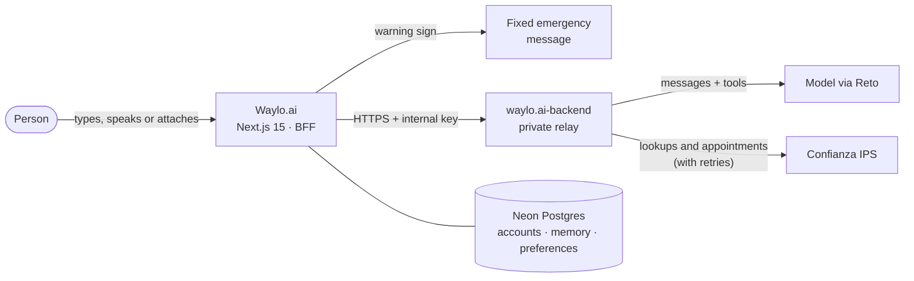
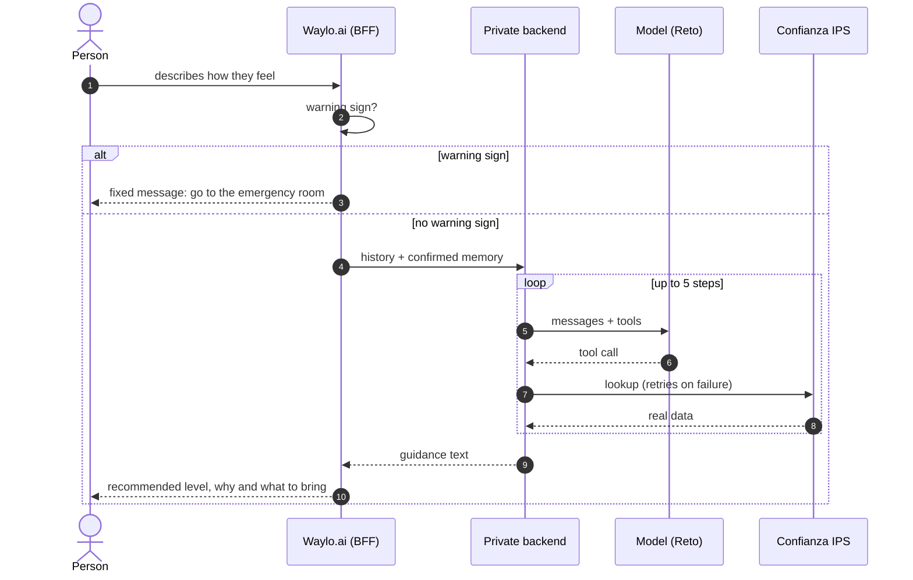

<div align="center">

<picture>
  <source media="(prefers-color-scheme: dark)" srcset="docs/assets/banner-dark.png">
  
</picture>

<br>

### We tell you which level of care to go to.
We guide, we don't diagnose. And when your health provider (IPS) is linked, Waylo acts for you with real tools.

<br>

[**Try the web app**](https://waylo-ai.vercel.app) &nbsp;·&nbsp; [The agent at work](#the-agent-at-work) &nbsp;·&nbsp; [Architecture](#architecture) &nbsp;·&nbsp; [Getting started](#getting-started) &nbsp;·&nbsp; [Docs](./docs/README.md) &nbsp;·&nbsp; [Backend](https://github.com/GustavoAdolfoNavarroPacheco/waylo.ai-backend)

<br>

[](https://github.com/GustavoAdolfoNavarroPacheco/waylo.ai/actions/workflows/frontend-ci.yml) [](https://waylo-ai.vercel.app) [](https://github.com/GustavoAdolfoNavarroPacheco/waylo.ai/commits/main) [](./LICENSE) [](./CONTRIBUTING.md#commit-convention)

      

</div>

---

> [!IMPORTANT]
> **Waylo is a guidance tool.** It does not diagnose, prescribe, or suggest medication, doses or home remedies, and it does not
> replace the assessment of a health professional. Whenever there is a warning sign, the answer is always the same: go to the
> emergency room right away or call the emergency line.

> [!NOTE]
> Waylo is built for the Colombian health system (EPS insurers and IPS providers), so the live app defaults to Spanish. It is
> also available in English and Portuguese.

## What is Waylo?

When something hurts, many people don't know whether to go to the emergency room, ask for a priority appointment or book a
general-medicine visit. The result: crowded emergency rooms with low-complexity cases, pointless trips and lost time, or the
opposite: waiting too long with something serious.

**Waylo listens to how you feel, in your own words, and tells you which level of care to go to:**

| Level | When | What you get |
| --- | --- | --- |
| **Emergency Care** | There are warning signs or the case requires it. | On a warning sign, a fixed, clear message: go to the emergency room now. |
| **Priority Consultation** | Something acute that cannot wait for a regular appointment. | The reason, what to bring and, with a linked IPS, the first available slots. |
| **General Medicine** | A case that is well served by an ordinary appointment. | The reason, what to bring and, with a linked IPS, your appointments and slots. |

The answer always has the same simple, short shape: **recommended level**, **why** and **what to bring**.

### How it works

1. **Tell it how you feel**: by typing, by talking (Waylo Live) or by attaching a document or a photo.
2. **Warning signs first.** Before any AI model takes part, a deterministic check looks for chest pain or pressure, severe
   difficulty breathing, paralysis or speech changes, bleeding that won't stop, loss of consciousness or thoughts of self-harm.
3. **You get your guidance.** If you linked your IPS, Waylo also looks up your profile, the catalog, the first available slots
   and your appointments with real tools; creating, cancelling or rescheduling an appointment always asks for your explicit
   confirmation.

## What it looks like

<p align="center">
  <picture>
    <source media="(prefers-color-scheme: dark)" srcset="docs/assets/screenshots/home-dark.png">
    
  </picture>
</p>

<table>
  <tr>
    <td width="50%" valign="top">
      <picture>
        <source media="(prefers-color-scheme: dark)" srcset="docs/assets/screenshots/steps-dark.png">
        
      </picture>
      <br><sub><b>How it works</b>: glass cards over out-of-focus shapes.</sub>
    </td>
    <td width="50%" valign="top">
      <picture>
        <source media="(prefers-color-scheme: dark)" srcset="docs/assets/screenshots/chat-dark.png">
        
      </picture>
      <br><sub><b>The chat</b>: text, attachments and voice.</sub>
    </td>
  </tr>
</table>

<p align="center">
  
  &nbsp;&nbsp;&nbsp;
  
  <br><sub>Phone first: it can be installed on the home screen.</sub>
</p>

## The agent at work

Waylo is not just a chat: once the person links their IPS, **the agent decides on its own which tool to use, calls the
institution's real API and recovers when something fails**.

<p align="center">
  
</p>

*Excerpt of a real run: the IPS fails on purpose (503), the backend waits 204 ms, retries, and the agent carries on until it
finds the first general-medicine slot. The run, its id and its timings are the recorded ones; the interface text is translated
to English for this demo.*

- **Real tools, not simulated**: profile, services and doctors catalog, first available slots, appointments, institutional
  history and certificates. Operations that write (create, cancel, reschedule) require explicit, signed confirmation.
- **Errors and retries**: the backend retries transient model and IPS failures with growing delays, and does not retry
  permanent authorization errors.
- **Recorded executions**: every call leaves a sanitized record (status, tools, retries, duration) in the `agent_executions`
  table; it never stores messages, arguments, tokens or keys.
- **Verifiable evidence**: **10 real end-to-end runs**, 10 out of 10 successful, with 4 tools and 6 Confianza IPS endpoints,
  and two injected failures the agent recovered from. Data and scripts are in [`docs/evidence`](./docs/evidence/README.md);
  the design is in [`docs/005`](./docs/005-hackathon-s2-delivery.md).

## Features

| Feature | What it offers |
| --- | --- |
| **Clear guidance** | Recommended level, reason and what to bring, in plain language; quick-reply buttons for common symptoms. |
| **Clinical safety first** | Warning signs are checked before the model, in several languages at once, and cut the flow with a fixed message. |
| **Agent with real tools** | IPS profile, catalog, slots, appointments, history and certificates; retries, normalized errors and traceability. |
| **Voice** | Voice conversation with Waylo Live: transcription and spoken reply, with a female or male voice to choose from. |
| **Attachments** | Images, PDF, Word and Excel: read on the server and sent along with the message. |
| **Your own clinical memory** | Stores only what the person confirms; it can be edited or deleted from Settings → Memory. |
| **Accounts and limits** | Sign up with email or Google; guests get free replies and accounts have daily and monthly limits. |
| **Three languages** | Spanish, English and Portuguese, with the same shape guaranteed by tests. |
| **Light and dark** | A monochrome design with a smooth theme transition, an animated mascot and a smooth cursor; reduced motion is respected. |
| **Installable** | Manifest, home-screen icon (iOS and Android) and a theme color per color scheme. |
| **Search friendly** | Metadata, Open Graph, sitemap, robots and structured data; the FAQ answers are in the HTML. |

## Architecture



The browser **never** receives keys or the IPS token: Next.js `/api/*` routes act as a BFF and delegate to a private backend,
the only one that talks to the model and to Confianza.



More detail: [technical architecture](./docs/product/Architecture.md), [IPS integration](./docs/001-ips-integration-mvp-prd.md) and
[chat with tools and memory](./docs/003-chat-ips-tools-memory-prd.md).

## Stack

| Layer | Technology |
| --- | --- |
| App | Next.js 15 (App Router, Turbopack), React 19, TypeScript 5 |
| UI | Tailwind CSS 4, Radix UI, motion, GSAP and Lenis, Hugeicons |
| AI | Vercel AI SDK with an OpenAI-compatible provider (Grok via Reto), Zod 4 |
| Data | Neon (serverless PostgreSQL) |
| Documents | unpdf, mammoth and read-excel-file |
| Quality | Vitest, ESLint, GitHub Actions, CodeQL, Dependabot |
| Delivery | Docker (Node 24) and Vercel |

## Getting started

**Requirements:** Node.js 24 (see [`.nvmrc`](./.nvmrc)), a PostgreSQL database (for example [Neon](https://neon.tech)) and, for
the chat with tools, the [backend](https://github.com/GustavoAdolfoNavarroPacheco/waylo.ai-backend) running.

```bash
git clone https://github.com/GustavoAdolfoNavarroPacheco/waylo.ai.git
cd waylo.ai

nvm use                      # Node 24
npm install                  # installs and enables the commit hook
cp .env.example .env.local   # fill in the variables (table below)
npm run db:migrate           # creates the tables
npm run dev                  # http://localhost:3000
```

### Environment variables

Keys are **server-only**: never give them the `NEXT_PUBLIC_` prefix.

| Variable | Required? | Purpose |
| --- | :---: | --- |
| `DATABASE_URL` | Yes | PostgreSQL connection (accounts, sessions, memory, preferences). |
| `AUTH_SECRET` | Yes | Signs sessions and cookies. A long random string. |
| `WAYLO_BACKEND_URL` | For the chat | Address of the private backend, e.g. `http://localhost:3001`. |
| `WAYLO_BACKEND_KEY` | For the chat | Internal key that must match the backend's (at least 32 characters). |
| `RETO_KEY` | Optional | AI provider for voice and conversation titles. |
| `RETO_BASE_URL`, `RETO_MODEL`, `RETO_TITLE_MODEL`, `RETO_VOICE` | Optional | Provider settings. |
| `AUTH_GOOGLE_ID`, `AUTH_GOOGLE_SECRET` | Optional | Sign in with Google. |
| `DISCORD_FEEDBACK_WEBHOOK_URL`, `DISCORD_ERRORS_WEBHOOK_URL` | Optional | Vote and error notices ([details](./docs/operations.md)). |
| `SITE_URL` | Optional | Public address, no trailing slash, for the canonical link, sitemap and share previews. |

### Scripts

| Command | What it does |
| --- | --- |
| `npm run dev` | Development server with Turbopack. |
| `npm run build` / `npm start` | Builds and serves the production version. |
| `npm run lint` | ESLint. |
| `npm test` | Tests with Vitest. |
| `npm run db:migrate` | Applies the migrations to the database. |

### With Docker

```bash
docker build -t waylo-frontend .
docker run --rm --env-file .env -p 3000:3000 waylo-frontend
```

## Project structure

```text
src/
├── app/          Routes (App Router): pages, the API that acts as BFF, manifest, icons and social image
├── components/   UI: home, chat, live (voice), mascot, settings, cursor, theme, ui
├── lib/          Server and domain logic: triage, warning signs, IPS, memory, session, usage
├── i18n/         es / en / pt texts and the common shape the tests require
├── design/       Design and motion tokens
└── data/         Seed data
scripts/          Migrations and commit-message check
docs/             Product, IPS integration, agent evidence, operations and images
.github/          CI, CodeQL, Dependabot, templates and code owners
```

## Quality and workflow

- **Tests:** more than 450 automated tests with Vitest, including warning-sign detection, the common shape of the three
  languages and the IPS integration contracts.
- **Continuous integration:** every push and pull request runs lint, tests and build; there is also CodeQL analysis and
  weekly dependency updates with Dependabot.
- **Conventional commits:** `type: description`, lowercase and in English, checked by a local hook and by a pull request check.
  See [CONTRIBUTING.md](./CONTRIBUTING.md#commit-convention).
- **Accessibility:** text colors with at least 4.5:1 contrast in both themes, visible focus and `prefers-reduced-motion` support.

## Security and privacy

- Keys live only on the server; the browser never receives the IPS token.
- Warning signs are evaluated **before** the model and do not query institutional data.
- Conversations are stored in the person's browser (up to 7 days), not on the server.
- Clinical memory only contains what the person confirmed, and they can delete it.
- Error notices hide passwords, tokens and emails, and never include the conversation text.

Found a vulnerability? Report it privately following [SECURITY.md](./SECURITY.md).

## Roadmap

- [x] Level-based guidance with warning-sign detection
- [x] Accounts, confirmed clinical memory, three languages, voice and attachments
- [x] Confianza IPS integration and an agent with real tools, retries and execution records
- [ ] Clinical audit of the answers by a health professional
- [ ] Regenerate `package-lock.json` and switch to `npm ci` in CI and Docker
- [ ] Publish the first tagged release

## Related repositories

| Repository | Role |
| --- | --- |
| [`waylo.ai-backend`](https://github.com/GustavoAdolfoNavarroPacheco/waylo.ai-backend) | Private relay to the model and the IPS, tools, retries and execution records. |
| [`confianza-ips-frontend`](https://github.com/Duran24062005/confianza-ips-frontend) | The integration IPS that Waylo connects to. |

## Team

<table>
  <tr>
    <td align="center" width="140"><a href="https://github.com/GustavoAdolfoNavarroPacheco"><br><sub><b>GustavoAdolfoNavarroPacheco</b></sub></a></td>
    <td align="center" width="140"><a href="https://github.com/Duran24062005"><br><sub><b>Duran24062005</b></sub></a></td>
    <td align="center" width="140"><a href="https://github.com/ThomR08"><br><sub><b>ThomR08</b></sub></a></td>
  </tr>
</table>

Want to help? Read [CONTRIBUTING.md](./CONTRIBUTING.md) and the [Code of Conduct](./CODE_OF_CONDUCT.md).

## License

**Proprietary, all rights reserved.** The code is public so that it can be read and evaluated, but it is not offered under an
open source license: it may not be copied, modified or reused without permission. See [LICENSE](./LICENSE).

<div align="center">
<br>
<sub>Waylo guides; it does not diagnose or prescribe. If you feel very unwell, go to the emergency room.</sub>
</div>
